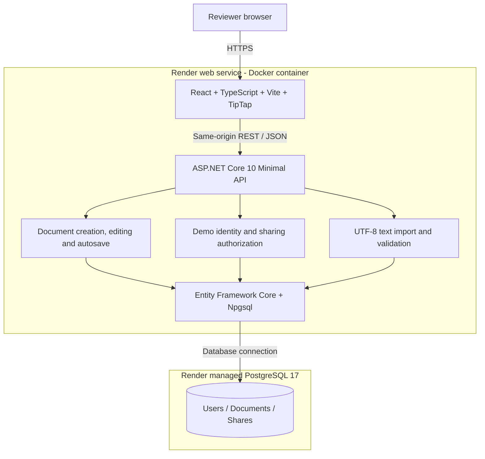

# DraftSpace architecture

The React client uses TipTap for editor state and sends JSON to a single ASP.NET Core API. Vite proxies API calls in development. The production container serves the built client and API from the same origin.

## System architecture

The production deployment packages the compiled React frontend and ASP.NET Core API in a single Docker image. The API accesses managed PostgreSQL through EF Core and Npgsql, storing TipTap documents as JSONB. Database credentials are supplied through environment configuration rather than committed to source control.

In local development, Vite proxies API requests to ASP.NET Core and Docker Compose provides PostgreSQL with a persistent named volume.

**Hosting limitation:** The Render free web service may spin down after inactivity. The first request may therefore take longer while the container starts. This is a deployment-tier trade-off, not a requirement for local execution.

## Data and access

- User stores the three seeded demo identities.
- Document references an owner, stores a title and UTC modification timestamp, and stores TipTap JSON in a PostgreSQL jsonb column.
- DocumentShare links a document and recipient. A composite primary key makes each grant unique. The owner can grant or revoke edit access.

The API derives the simulated actor from the X-Demo-User header and confirms the actor exists. Document queries filter by ownership or a share grant. An inaccessible document returns 404. A recipient attempting owner-only share management receives 403. A missing or invalid demo identity receives 401. Simulated authentication trusts the caller-controlled header, so these checks demonstrate authorization under a selected identity.

## Editor and persistence

The client debounces writes by 700 ms and serializes saves within an editor session. The Documents button flushes pending edits before returning to the dashboard. Each save sends the title and entire TipTap document. Concurrent editor sessions use last-write-wins semantics.

Import validates the .txt extension, a 256 KB file limit, strict UTF-8 decoding and unsupported controls on the server. It converts plain text into TipTap paragraphs. Document saves also validate the title, JSON structure and content size.

EF Core initializes an empty demo database on startup. Docker Compose keeps PostgreSQL data in the named volume. Schema evolution would require EF migrations as the application grows.

## Verification

The xUnit suite exercises the HTTP API against real PostgreSQL using a separate database per test case. A headless Chrome smoke test exercised the packaged UI at mobile width.

